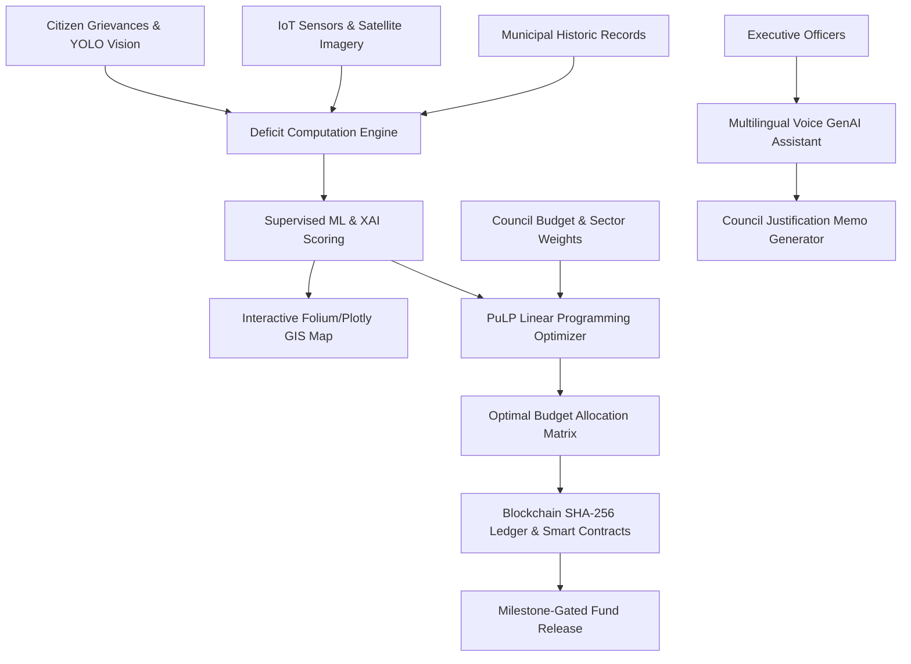

# 🏛️ InfraBudget AI: Data-Driven Ward-Wise Fund & Resource Allocator
> **B.Tech Minor Project & B2G GovTech SaaS Platform**  
> *Empowering Municipal Corporations with Algorithmic Capital Allocation, GIS Deficit Mapping, and Blockchain Anti-Leakage Escrow.*

---

## 🌟 Executive Overview
Traditional municipal budget allocation across Indian and global cities frequently suffers from **subjective political bias, historical inertia, and zero data-backed auditability**. This creates acute disparities where congested or vulnerable wards suffer from chronic road degradation, water shortages, and sewer overflows, while affluent wards receive redundant capital expenditure.

**InfraBudget AI** is a full-stack, enterprise-grade GovTech command center that replaces guesswork with:
1. **Multi-Source Spatial Telemetry**: Geospatial mapping with real-time IoT drain/water sensors, VIIRS satellite night-light radiance, and Urban Heat Island (UHI) indices.
2. **Supervised ML & Explainable AI (XAI)**: Random Forest & Gradient Boosting models calculating Infrastructure Deficit Scores (0-100) with SHAP-style waterfall root-cause attribution.
3. **PuLP Linear Programming Optimization**: Constrained optimization solving for Pareto-optimal fund distribution subject to municipal equity guarantees and sectoral priorities.
4. **Blockchain Anti-Leakage Escrow**: Distributed SHA-256 tamper-proof ledger with smart contract milestone gates (Drone LiDAR & Citizen Sign-off) preventing fund leakage.
5. **Citizen Crowdsourcing with YOLOv8 Damage Vision**: Automated detection of potholes, garbage dumps, and pipe bursts from citizen photos with instant deficit score recalibration.
6. **Multilingual Voice-Enabled GenAI Copilot**: Bilingual (English / हिंदी) conversational assistant with Web Speech synthesis and automated Commissioner Justification Memo export.

---

## 🏗️ System Architecture



---

## 📁 Repository Structure

```
infraBudget - AI/
├── app.py                     # Main Streamlit Command Center entrypoint
├── config.py                  # Theme tokens, municipal metadata, sector constants
├── requirements.txt           # Project dependencies
├── README.md                  # Comprehensive documentation and pitch deck
│
├── assets/
│   └── style.css              # Custom modern GovTech CSS design system
│
├── sample_images/             # Pre-generated sample images for YOLO vision testing
│   ├── sample_pothole.jpg
│   ├── sample_garbage.jpg
│   └── sample_broken_pipe.jpg
│
└── modules/
    ├── __init__.py
    ├── data_generator.py      # 16-ward municipal dataset with GIS, telemetry & K-Means
    ├── gis_engine.py          # Folium & Plotly interactive choropleths and popups
    ├── ml_engine.py           # ML regressor (Random Forest/GBM) & XAI waterfall attributions
    ├── optimization.py        # PuLP Linear Programming resource allocator
    ├── blockchain.py          # SHA-256 ledger, smart contracts & escrow gates
    ├── vision_detector.py     # YOLO computer vision damage detector & penalty engine
    └── genai_assistant.py     # Multilingual GenAI Copilot & justification report generator
```

---

## 🚀 Quick Start Guide

### 1. Prerequisites
- Python 3.9+ or Python 3.10+
- Modern Web Browser (Chrome, Edge, Firefox, Brave)

### 2. Installation
```bash
# Clone or navigate to the directory
cd "infraBudget - AI"

# Install dependencies
pip install -r requirements.txt
```

### 3. Launch the Application
```bash
streamlit run app.py
```
The command center will automatically launch at `http://localhost:8501`.

---

## 📊 Modules & Functional Capabilities

### 🗺️ Tab 1: Command Center & GIS Map View
- **City-wide KPI Cards**: Real-time counts of Total Wards, Critical Deficit Wards, Current Budget Pool, and Average Infrastructure Deficit.
- **Interactive Folium GIS Map**: Circular markers with custom HTML popups indicating road age, water deficit %, 30-day complaints, and K-Means archetype cluster.
- **Interactive Layer Switch**: Toggle between Deficit Risk view (Soft Red / Amber / Green) and K-Means Archetype Zones.
- **Ward Diagnostic Inspector**: Detailed inspection drawer for deep-dive ward profiles.

### 📊 Tab 2: Predictive Deficit Analytics & Satellite/IoT Telemetry
- **Model Evaluation**: Displays $R^2$ goodness-of-fit, MAE, and RMSE of the supervised deficit regressor.
- **Explainable AI (XAI)**: Ward-specific SHAP-style waterfall bar chart showing how road age, water deficit, and complaints shift the score above or below the city baseline.
- **Earth Observation & IoT**: Satellite Night-Light Radiance (VIIRS), Urban Heat Island (UHI) thermal anomaly vs Green Canopy %, and live ultrasonic drain silt level telemetry.

### 💰 Tab 3: Budget Simulator & Blockchain Fund Tracking
- **PuLP Mathematical Optimizer**: Formulates and solves a constrained linear programming model to maximize city-wide deficit reduction.
- **Interactive Comparison**: Plotly grouped bar chart comparing historic discretionary allocations against AI-optimized capital distribution.
- **Blockchain Distributed Ledger**: Immutable SHA-256 hash-chained transaction blocks recording disbursements.
- **Smart Contract Escrow**: Milestone gates (Drone LiDAR verification, IoT sensor pings, citizen satisfaction quorums) ensuring zero fund leakage.

### 📱 Tab 4: Citizen Crowdsourcing & YOLO Vision
- **Computer Vision Damage Detection**: Simulated YOLO inference bounding boxes detecting potholes, garbage dumps, and ruptured water pipes.
- **Live Deficit Recalibration**: Immediate penalty points added to the offending ward's score upon grievance verification.
- **Participatory Budgeting**: Direct citizen democracy portal allowing residents to upvote local micro-projects.

### 🤖 Tab 5: Multilingual Voice-Enabled GenAI Municipal Assistant
- **Bilingual & Hinglish Copilot**: Handles queries in English and Hindi (*"वार्ड 08 में सबसे बड़ी समस्या क्या है?"*).
- **Text-to-Speech Voice Briefing**: Integrated Web Speech API audio synthesis for audio playback.
- **Executive Justification Report**: Automated generation of official council-ready memorandum downloadable in Markdown.

---

## ⚖️ License & Academic Citation
Developed for B.Tech Minor Project / B2G Startup Competition.  
Licensed under the **MIT License**.
